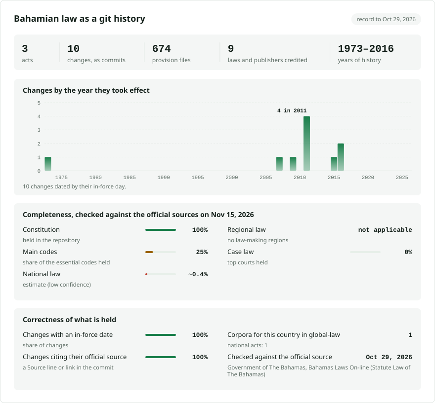

# The Bahamas: law history in git

<picture>
<source media="(prefers-color-scheme: dark)" srcset="data/effort-dark.svg">

</picture>

The law of The Bahamas as a git history: one file per section or article, one commit per change on the day it took effect, and the law that made each change as the commit's author. `git blame` names the law behind every paragraph; `git log` lists every change to a section; picking a date gives the text in force that day.

Part of [lexifina/global-law](https://github.com/lexifina/global-law), one git history for every country's law: this is the Bahamas' national law, which global-law reads at `bahamas/national/acts/`.

**What is in it now:** three acts from the *Statute Law of The Bahamas*: the Constitution of the Commonwealth of The Bahamas, in one version (in force from 10 July 1973); the Penal Code (Ch. 84), in 7 versions from 1 October 2009 to 31 December 2016; and the Data Protection (Privacy of Personal Information) Act (Ch. 324A), in one version (in force from 2 April 2007). [`data/laws.csv`](data/laws.csv) lists the 62 laws the record names, with the day each took effect where it made a change; each act's `README.md` lists its provisions and when each changed.

Each act has its own folder, one file per section or article: `penal-code/s-290.md` is section 290 of the Penal Code, the definition of murder; the Constitution is in `constitution/` (`art-001.md` onward, with `preamble.md`) and the Data Protection Act in `data-protection/`.

The text is in English, as the Government's revised editions print it in their PDFs.

## Questions as git commands

| Question | Command |
| --- | --- |
| Every change to section 290 of the Penal Code | `git log -p --word-diff -- penal-code/s-290.md` |
| Which law wrote each line of section 290? | `git blame penal-code/s-290.md` |
| Every version of the Penal Code, with the day each took effect | `git log --format="%h %(trailers:key=In-force,valueonly,separator=) %an" -- penal-code ':!penal-code/README.md'` |
| Section 290 as in force on 1 January 2011 | `python tools/on.py 2011-01-01 penal-code s-290` |

**Outside git**, we also host this record publicly, for free:

- **[Ask Claude about Bahamian law](https://global-law.lexifina.com/v1/try_claude?country=bahamas)**: opens Claude with a first question ready.
- **[Ask ChatGPT](https://global-law.lexifina.com/v1/try_chatgpt?country=bahamas)**: the same question in ChatGPT.
- **[Search Bahamian law on our site](https://lexifina.com/law?country=bahamas&q=murder)**: a search for "murder", with each provision's text and its versions, no account needed.
- **[Developer REST API](https://global-law.lexifina.com/v1/search_law?query=murder&jurisdiction=bahamas)**: the same search as JSON, with no key. See the [documentation here](https://lexifina.com/api/global-law).

Both assistants read the record through the free Global law connector (MCP, `https://global-law.lexifina.com/mcp`); the first time, the chat gives you the link that adds it. Ask in English.

**Host it yourself easily.** All it takes is git and Python, and the tools run on your machine:

```sh
git clone --depth 1 https://github.com/lexifina/global-law && cd global-law
python3 tools/countries.py add bahamas/national/acts
python3 tools/law.py show 2026-01-01 bahamas/national/acts/penal-code/s-290.md
```

Opened in Claude Code, Cursor, VS Code or Codex, the clone also starts a local MCP server with the same tools ([MCP.md](https://github.com/lexifina/global-law/blob/main/MCP.md)).

## Dates

Each commit is dated at noon, America/Nassau, on the day the change took effect, and carries it in its `In-force:` trailer:

- every day is a "Date Commenced" from the publisher's own act index or its Acts by Year list; none is taken from publication;
- the Penal Code's first version is the 2010 revised edition (LRO 1/2010), dated 1 October 2009, the commencement of the last law it lists (Act 1 of 2007); its other versions come from the 2017 edition (LRO 1/2017), each section whose amendment note names a newer law taking its new wording on that law's commencement day;
- Act 28 of 2008 (ss 88A, 126, 127) has no commencement date on the site, so it is dated 31 December 2016, the day the first edition holding it became current.

Each change is credited to the law the 2017 edition's amendment notes name (`Act 34 of 2011`); the Constitution to The Bahamas Independence Order 1973 (S.I. 1973 No. 1080), and the Data Protection Act to itself (Act 3 of 2003). The Penal Code's first version, and 9 sections that differ between the editions with no note, are credited to the publisher, the latter labelled "unexplained".

## How it is checked

- `tools/check_repo.py` reads every version back from git on the day it took effect and on the day before and compares it with the corpus: 9 versions of 3 acts, 0 mismatches (see [`REPRODUCE.md`](REPRODUCE.md)).
- Each act's latest version is exactly the consolidation the publisher's index serves as current on the retrieval day (29 October 2026).
- Credits come only from the publisher's amendment notes and its index; whatever they do not explain is committed by the publisher and labelled "unexplained".
- History is append-only: no merge commits, no dates going backwards, no commit dated after the build, and every commit's trailers parse.

## What it does not show

- **Most Bahamian law.** Only these three acts: no other act, no subsidiary legislation and no case law.
- **Amendments the publisher has not consolidated.** The Penal Code (Amendment) Acts of 2018, 2020 and 2024, and the Constitution (Amendment) Act, 2017 (served only as a scanned image, with no text layer; nothing here is read by OCR), are in no consolidation the site serves, so they are not applied.
- **Earlier history.** Every Penal Code change before the 2010 edition is folded into its first version.
- **Typesetting.** Running heads, footnotes, amendment notes and Part, Book and Title headings are left out; spacing, quotes and dashes are normalised.
- **Changes within a line.** Each paragraph is one line, so blame credits a whole paragraph to the law that changed one word of it.

## Sources

| Source | Kind | Past versions | Notes |
| --- | --- | --- | --- |
| [Bahamas Laws On-line](https://laws.bahamas.gov.bs) (Government of The Bahamas) | Official legislation site: the *Statute Law of The Bahamas* | yes, each revised edition as a PDF, with a point-in-time act index | The text from each PDF's text layer; the commencement day of each amending Act from the index and Acts by Year |

## Licence

See [`LICENSE`](LICENSE). The publisher's Copyright page makes the legislation subject to Government of The Bahamas copyright, requires any reproduction to be accurate and to make its source and copyright status evident, and allows the site to be used for informational non-commercial purposes; it gives no licence to republish. Lexifina's arrangement, commit messages, tables and tools are CC0 1.0.

No AI model wrote, translated or corrected legal text, and none runs when the history is built; the scripts were written by an AI model (see [`REPRODUCE.md`](REPRODUCE.md)).

## More

From [lexifina/global-law](https://github.com/lexifina/global-law):

- [FEATURES.md](https://github.com/lexifina/global-law/blob/main/FEATURES.md): every feature, and what every corpus must support (`git blame`, `law.py`, the MCP tools)
- [FAQ.md](https://github.com/lexifina/global-law/blob/main/FAQ.md): questions and answers · [CONTRIBUTING.md](https://github.com/lexifina/global-law/blob/main/CONTRIBUTING.md): proposing changes · [MCP.md](https://github.com/lexifina/global-law/blob/main/MCP.md): the MCP server · [REPRODUCE.md](https://github.com/lexifina/global-law/blob/main/REPRODUCE.md): how it was built · [CHANGELOG.md](https://github.com/lexifina/global-law/blob/main/CHANGELOG.md)
- [FRESHNESS.md](https://github.com/lexifina/global-law/blob/main/FRESHNESS.md): how current each corpus is · [Monitoring](https://github.com/lexifina/global-law/tree/main/monitoring): whether updates are running · [WATCHING.md](https://github.com/lexifina/global-law/blob/main/WATCHING.md): how each official source is watched for changes
- [performance/](https://github.com/lexifina/global-law/tree/main/performance): how fast the tools are, measured
- [visualisations/](https://github.com/lexifina/global-law/tree/main/visualisations): charts and bridges across the world's law
- [Vulnerabilities](https://github.com/lexifina/global-law/tree/main/vulnerabilities): mistakes in legislation as published
